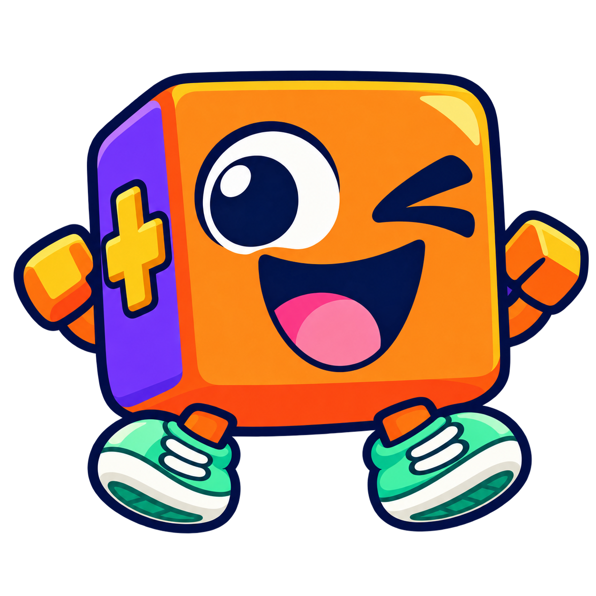

<p align="center">
  
</p>

<h1 align="center">Plocks</h1>
<p align="center"><strong>Small games. Real Python. Your rules.</strong></p>

Moving on from Scratch? Build desktop Python games with ready-made pictures and simple
movement scripts. Start with an example, then make it your own!

## 🎮 Play your first game

You need **Python 3.12+**. Ask a grown-up for setup help if needed.

```sh
python -m venv .venv
# macOS / Linux:
source .venv/bin/activate
# Windows PowerShell instead: .venv\Scripts\Activate.ps1
python -m pip install --upgrade "https://github.com/vivsh/plocks/archive/refs/heads/main.zip"
plocks examples
plocks run platformer
```

**Arrows** move · **Space** jumps · **R** restarts. Can you reach the gold flag?

This installs directly from GitHub; no clone or git pull is needed. Plocks is not
on PyPI yet. The examples and pictures come with the install. It includes pygame-ce—
keep the separate `pygame` package out of this environment.
Games run in their own desktop window.

## 🔬 Try ideas live with IPython

Change a character and see what happens straight away—without restarting the game!
With Plocks installed, make a playground and open IPython:

```sh
python -m pip install "ipython>=9,<10"
plocks examples platformer --copy-to playground
cd playground
ipython
```

Enter these lines at the IPython prompt:

```python
from plocks import Sprite, Stage

stage = Stage(background="midnightblue")
hero = Sprite("assets/hero.png")
stage.add(hero)
stage.run(interactive=True)
```

The game stays open and the prompt comes back. Try each line and watch your hero:

```python
hero.x = 100
hero.say("Hello!")
hero.glide_by(x=-100, seconds=1)
```

Try `hero.glide_by?` to read its help.

Use `stage.pause()` to freeze the game, `stage.resume()` to continue, and
`stage.stop()` to close it. After closing, make a new `Stage` to play again.
The game keeps running when you switch to the terminal. Hiding or minimizing its
window pauses it.

Use **terminal IPython** with its normal prompt. This mode opens a desktop window;
notebook cells and `--simple-prompt` aren't supported. Keep commands short: a long
Python command occupies the same thread as the game. Ordinary game files still use
`stage.run()` and work as before.

## 📚 Learn step by step

[Start learning here](docs/index.md): setup, the dinosaur course, small activities, artwork and help.

| Start where you are | Your guide |
| --- | --- |
| New to Python | [Build Dino Dash, one small step at a time](docs/dino-run/index.md) |
| Coming from Scratch | [Turn familiar blocks into Python](docs/start/from-scratch.md) |
| Want your own artwork | [Draw with Pixelorama](docs/art/pixelorama.md) |
| Want your own level | [Paint a world with Tiled](docs/art/tiled.md) |
| Need ready-made pictures | [Download the dinosaur sprite pack](docs/dino-run/assets.md) |
| Curious about more tools | [Choose a small activity](docs/activities/index.md) |

## 🗺️ Pick an adventure

| Game | Your mission | New ideas to try |
| --- | --- | --- |
| [Dino Dash](src/plocks/_games/dino_run) | Jump cacti, duck birds and collect coins | A complete beginner course, physics, scores, restart |
| [Sky Steps](src/plocks/_games/platformer) — start here | Ride a lift and reach the flag | Physics, repeating moves, checkpoints |
| [Beat Blocks](src/plocks/_games/geometry_dash) | Jump over spikes | Timing, gravity, crash checks |
| [Asset Workshop](src/plocks/_games/asset_workshop) | Use Tiled and Pixelorama artwork | Exported levels, animation, two-player controls |
| [Scrolling World](src/plocks/_games/scrolling_world) | Explore and paint a world | Tile grids, layers, a following camera |
| [Coin Quest](src/plocks/_games/mario) | Grab coins and stomp enemies | Lists, solid tiles, scoring |
| [Temple Trail](src/plocks/_games/temple_run) | Jump, slide and turn corners | Movement scripts, costumes, perspective |
| [Snake Run](src/plocks/_games/snake_run) | Eat apples and grow a tail | Remembering positions, size and distance |
| [Fruit Slice](src/plocks/_games/fruit_ninja) | Swipe fruit, dodge bombs | Mouse input, randomness, swipe maths |
| [Jungle Run](src/plocks/_games/jungle_run) | Run, jump and shoot robots | Bullets, health, several things moving together |

Each `main.py` has short comments. Start small; Fruit Slice and Jungle Run are
stretch challenges. Run a bundled game from any folder with `plocks run NAME`.
The older spelling `plocks run examples/NAME` works too.

To change a game, make your own copy:

```sh
plocks examples platformer --copy-to my-game
cd my-game
python main.py
```

Choose a new folder name: Plocks never overwrites an existing game. Your copy
includes its pictures and sounds. `plocks run path/to/my-game` also runs local
projects; an existing local folder takes precedence over a bundled name.

## ✨ Make a character hop

Make the `my-game` copy above, replace its `main.py` with this code, and run
`python main.py` inside that folder. Keep its `assets` folder.

```python
from plocks import Key, Sprite, Stage

# Make the stage and hero before connecting their controls.
stage = Stage()
hero = Sprite("assets/hero.png")
stage.add(hero)

# A sequence is a script: go up, then come back down.
hop = hero.sequence()
hop.glide_by(y=60, seconds=0.3)
hop.glide_by(y=-60, seconds=0.3)


# Bind the script directly. Extra presses are ignored until this hop finishes.
hero.on_key_down(Key.SPACE, hop)

# Start only when we run this file directly.
if __name__ == "__main__":
    stage.run()
```

Press **Space**! Change `60` to `100` in both moves for a bigger hop.
**Coordinates:** the middle is `(0, 0)`; x goes right and y goes up.

Each example puts setup first, functions underneath, and the guarded `stage.run()`
last. Importing the file prepares its pictures and game objects, but does not start
its window. Use `global score` to reassign the shared score inside a function;
changing `hero.x` or adding to a list does not need `global`.

## 🧰 Python tools you'll meet

| Tool | What it does in a game |
| --- | --- |
| Variables and `True` / `False` | Remember a score or whether you have won |
| `if` / `else` | Choose what happens: collect a coin or lose a life |
| Functions (`def`) | Give a job a name, like `jump` or `restart` |
| `for` loops | Do a job for every coin, enemy or tile |
| Lists and tuples | Keep several things together, like coins or an `(x, y)` position |
| Dictionaries | Find a picture by its name, such as `"coin"` |
| Events (`@...`) | Tell Plocks when to call a function: on a key press or each game step |
| `global` | Let a function change a game variable, such as `score`, from the top of the file |
| f-strings (`f"Score: {score}"`) | Put a changing number into words on screen |

**Events:** handlers receive `event.target` (who receives it), `event.source` (who caused it),
and `event.data` (what happened). Broadcast messages use the same Event shape.
**Timing:** an update's `event.data` is one game step's time; speed × time gives movement.
**Type hints:** `: float` means a number with decimals; `-> None` means a function has no result.
**Scripts:** one script can run on several characters; each gets its own turn.
Try [character memory](docs/activities/memory.md), such as
`hero.state.health`. Declare it with a normal Python dataclass and change it in
your functions. Use `stage.state.score` for a shared score.

Make your own pictures with [Tiled and Pixelorama](docs/art/index.md), or give a friend
[gamepad and keyboard controls](docs/activities/controls.md). Hover over Plocks names in your
Python editor for help.

## 🚀 Make it yours

1. Change one speed, colour or picture.
2. Play again and see what changed.
3. Invent a new rule!

Find small challenges in each game's README. These are keyboard/mouse games;
Snake Run and Temple Trail look 3D using flat pictures.
