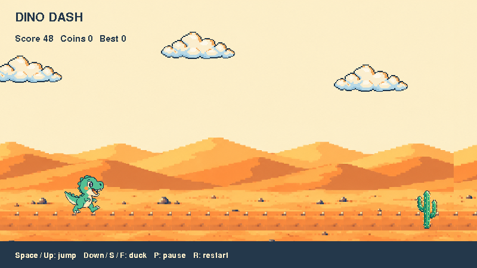

# Build Dino Dash 🦖

[Home](../index.md)

Your dinosaur runs through a desert. Jump over cacti, duck birds, and grab coins!
We will build it in small steps using real Python and ready-made pictures.



## Get ready

Ask a grown-up to help install **Python 3.12+** and Plocks using the
[setup steps](../start/index.md).

Make a copy of the included game, then open its folder in your editor:

```sh
plocks examples dino_run --copy-to dino_run
cd dino_run
python 01_hello.py
```

You can also [download the whole project](../downloads/dino-dash.zip) and unzip it.
Use the environment where Plocks is installed.

Close one game window before starting another. You can also use
`python path/to/dino_run/01_hello.py` from elsewhere: pictures live beside the code.

## Your journey

| Step | You will learn | Run this file |
| --- | --- | --- |
| [1. Meet your dinosaur](01-first-game.md) | Imports, names, pictures, the stage | `01_hello.py` |
| [2. Take control](02-controls.md) | Coordinates, functions, events, scripts | `02_controls.py` |
| [3. Jump and land](03-jump-and-scroll.md) | Gravity, ground, scrolling | `03_jump.py` |
| [4. Add a challenge](04-obstacles-and-score.md) | Lists, choices, messages, scores | `main.py` |
| [5. Finish the game](05-finish-game.md) | Ducking, coins, sound, pause, restart | `main.py` |
| [6. Try more Plocks](06-more-plocks.md) | Art, Puppets, memory, two players | `labs/` files |

Each checkpoint is a **complete program**. Read it, run it, change one thing,
then try the next. The last two steps explore parts of the finished `main.py`;
they are not extra files to paste underneath it.

Need pictures only? [Download the sprite pack](assets.md).
Coming from Scratch? [Start with familiar ideas](../start/from-scratch.md).
Ready for another idea? [Choose a small activity](../activities/index.md).
